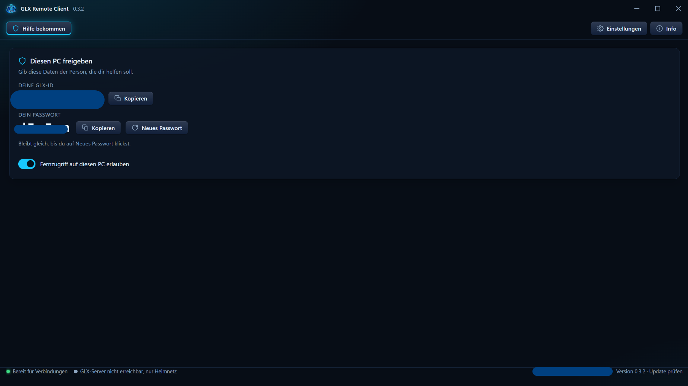
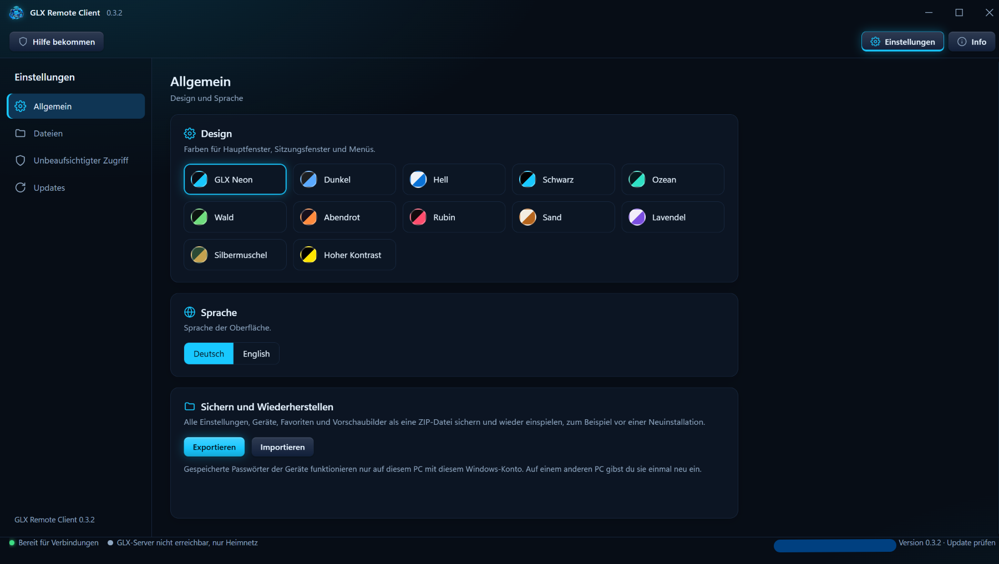
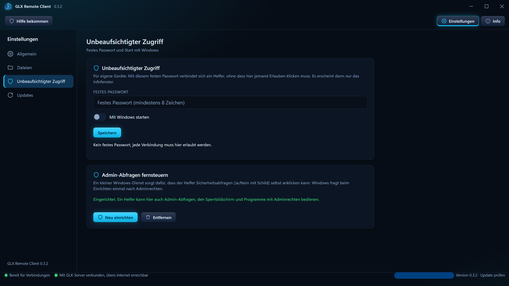
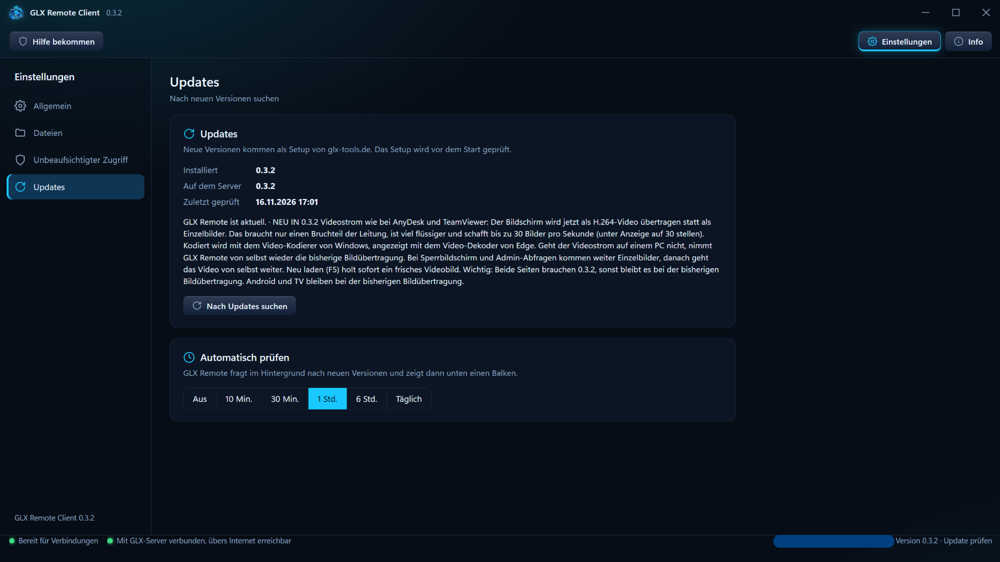

🌍 Sprachen: [🇺🇸 English](README.md) | [🇩🇪 Deutsch](README.de.md)

# 💠 GLX Remote Quick

### Fernhilfe in einer Minute, ohne Installation.

*Herunterladen, starten, GLX-ID und Passwort weitergeben, fertig. GLX Remote Quick ist kostenlos und hinterlässt nichts auf dem PC.* ⚡

   

---

## ⬇️ Download

👉 Neueste Version: [Releases](../../releases/latest)  
👉 Shop und Lizenzen: [glx-tools.de](https://glx-tools.de/product/glx-remote-quick/)

---

## 📖 Über GLX Remote Quick

### Hilfe in einer Minute

Manchmal muss es einfach schnell gehen. GLX Remote Quick ist eine einzelne Datei, die du ohne Installation startest. Sofort siehst du deine GLX-ID und ein Passwort. Gib beides der Person, die dir helfen will, klicke auf Erlauben, und sie kann deinen Bildschirm sehen und steuern.

### Ein neues Passwort für jede Sitzung

GLX Remote Quick erstellt bei jedem Start und nach jeder Sitzung ein neues Passwort. Ist die Hilfe vorbei, gilt das alte Passwort nicht mehr. Schließt du das Programm, läuft nichts im Hintergrund weiter.

### Alles Wichtige dabei

Auch mit GLX Remote Quick zeigt ein Infofenster, wer gerade verbunden ist und wie lange schon. Du kannst chatten, über dein Mikrofon mit dem Helfer sprechen, Dateien und Screenshots schicken und die Verbindung jederzeit trennen.

### Perfekt für Kunden und spontane Hilfe

Schick einfach den Download-Link. Dein Gegenüber muss nichts einrichten und braucht keine Administratorrechte zum Installieren. Für Menschen, denen du öfter hilfst, ist GLX Remote Client die bessere Wahl, weil er dauerhaft bereitsteht und das Passwort behält.

### Verbindung im Netzwerk und über das Internet

Im selben Netzwerk, zum Beispiel zu Hause oder im Büro, funktioniert die Hilfe schon heute direkt von PC zu PC.

Über das Internet, also wenn dein Helfer an einem anderen Ort sitzt, läuft die Verbindung über den GLX-Server.

GLX Remote Quick meldet neue Versionen selbst und öffnet dann die Downloadseite.

---

## 📸 Überblick & Screenshots

### 1️⃣ Hauptfenster

### 2️⃣ Ansicht 2

### 3️⃣ Ansicht 3

### 4️⃣ Ansicht 4

---

## ✨ Funktionen

- 🚀 **Keine Installation:** Eine Datei, starten und los. Läuft aus jedem Ordner oder vom USB-Stick, ohne Administratorrechte.
- 🧩 **Hilfe in einer Minute:** GLX-ID und Passwort erscheinen sofort. Weitergeben, Erlauben klicken, fertig.
- ⚙️ **Neues Passwort pro Sitzung:** Bei jedem Start und nach jeder Sitzung entsteht ein neues Passwort, alte Passwörter funktionieren nie wieder.
- 🔒 **Hinterlässt nichts:** Nach dem Schließen läuft nichts im Hintergrund weiter und nichts bleibt installiert.
- 📂 **Infofenster:** Zeigt, wer wie lange verbunden ist, mit dem Trennen-Knopf immer griffbereit.
- ⚡ **Chat und Sprache:** Schreibe oder sprich während der Sitzung über dein Mikrofon mit deinem Helfer.
- 🎨 **Dateien und Screenshots:** Dateien und Screenshots mit einem Klick an deinen Helfer senden.
- 🌍 **Heimnetz und Internet:** Direkt im selben Netzwerk, verschlüsselt über den GLX-Server im Internet.
- 🛠️ **Ideal für Kunden:** Einfach den Download-Link schicken. Für Menschen, denen du oft hilfst, ist GLX Remote Client die dauerhafte Lösung.
- 📊 **Kostenlos, 12 Designs:** Keine Kosten, keine Werbung, Deutsch und Englisch, meldet neue Versionen von selbst.

---

## 🧩 Systemanforderungen

- Windows 10 oder Windows 11 (64-Bit)
- Microsoft Edge WebView2 (in aktuellen Windows-Versionen enthalten)

---

## 🧪 Testzeitraum & Lizenz

Kostenlos. Der Helfer nutzt GLX Remote Windows.

---

## 🔗 Mehr zu diesem Produkt

👉 [glx-tools.de](https://glx-tools.de/product/glx-remote-quick/)  
Support: **info@glx-tools.de**

---

## 📄 Lizenz

Copyright © 2026 GLX Tools – Gordon Lehmann. Alle Rechte vorbehalten.  
Dies ist proprietäre kommerzielle Software. Es wird keine Open-Source-Lizenz gewährt. Dieses Repository enthält nur Release-Downloads und Dokumentation; der Quelltext wird nicht veröffentlicht.

---

Mit ❤️ gemacht von **Dreamdancer100**

