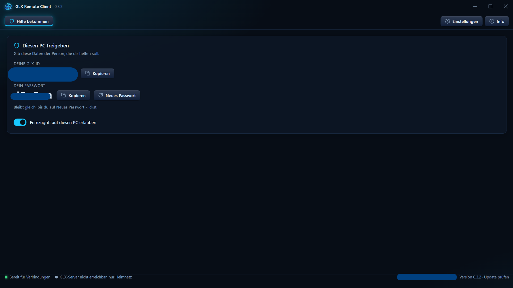
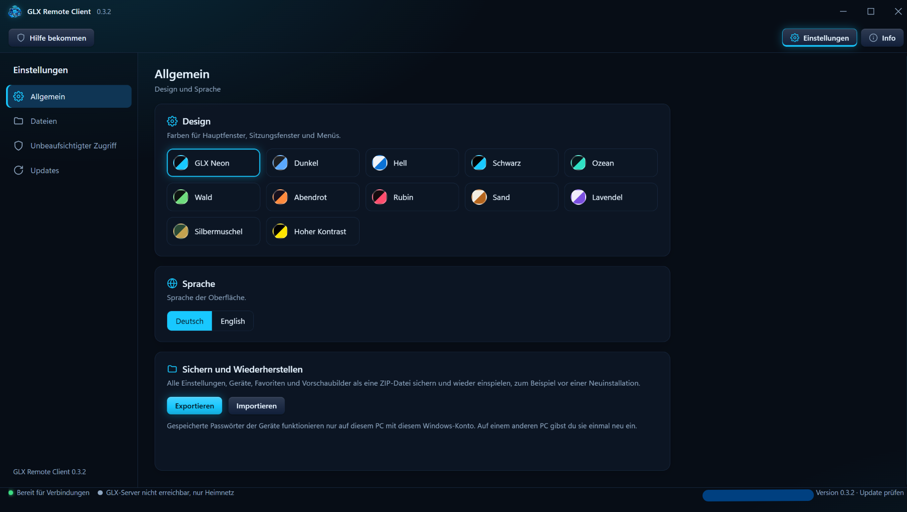
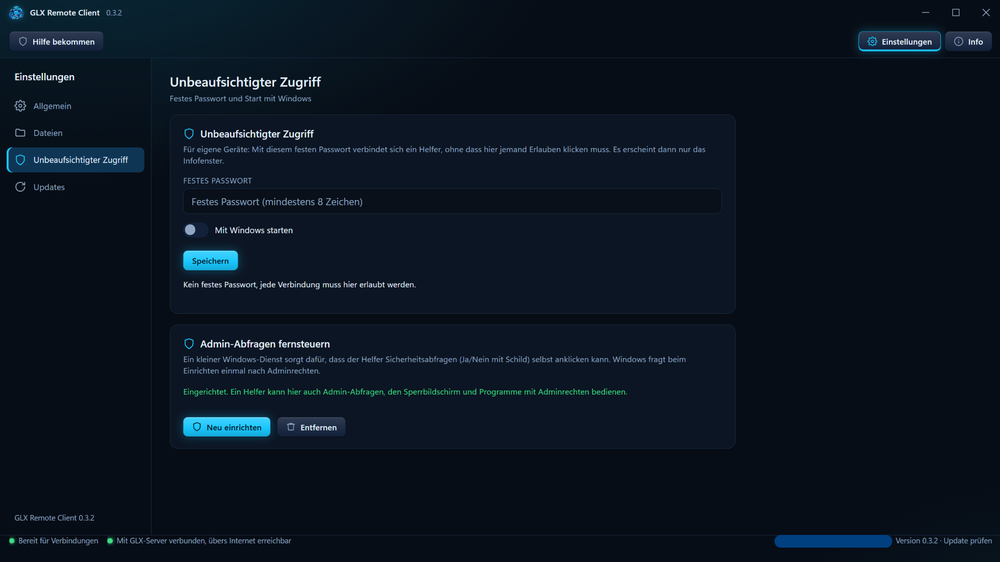
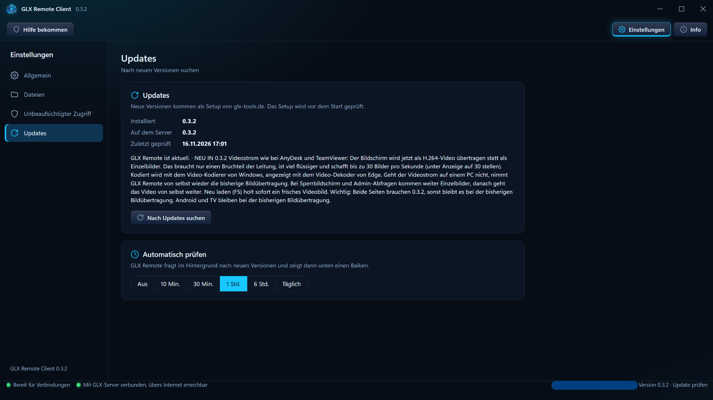

🌍 Languages: [🇺🇸 English](README.md) | [🇩🇪 Deutsch](README.de.md)

# 💠 GLX Remote Quick

### Remote help in one minute, without installation.

*Download, start, pass on GLX ID and password, done. GLX Remote Quick is free and leaves nothing behind on the PC.* ⚡

   

---

## ⬇️ Download

👉 Latest version: [Releases](../../releases/latest)  
👉 Shop and licences: [glx-tools.de](https://glx-tools.de/product/glx-remote-quick/)

---

## 📖 About GLX Remote Quick

### Help in one minute

Sometimes it just has to be quick. GLX Remote Quick is a single file that you start without installing. You see your GLX ID and a password right away. Give both to the person who wants to help, click Allow, and they can see and control your screen.

### A new password for every session

GLX Remote Quick creates a new password at every start and after every session. Once the help is over, the old password is no longer valid. When you close the program, nothing keeps running in the background.

### Everything important included

With GLX Remote Quick too, an info window shows who is connected and for how long. You can chat, talk to your helper via your microphone, send files and screenshots and end the connection at any time.

### Perfect for customers and spontaneous help

Just send the download link. The other person does not have to set anything up and needs no administrator rights to install. For people you help more often, GLX Remote Client is the better choice because it is always ready and keeps its password.

### Connection in the network and over the internet

In the same network, for example at home or in the office, help works directly from PC to PC.

Over the internet, when your helper is somewhere else, the connection runs through the GLX server.

GLX Remote Quick reports new versions itself and then opens the download page.

---

## 📸 Overview & Screenshots

### 1️⃣ Main window

### 2️⃣ View 2

### 3️⃣ View 3

### 4️⃣ View 4

---

## ✨ Features

- 🚀 **No installation:** One file, start it and go. Works from any folder or USB stick, no admin rights needed.
- 🧩 **Help in one minute:** GLX ID and password appear right away. Pass them on, click Allow, done.
- ⚙️ **New password every session:** A fresh password is created at every start and after every session, so old passwords never work again.
- 🔒 **Leaves nothing behind:** When you close it, nothing keeps running in the background and nothing stays installed.
- 📂 **Info window:** Shows who is connected and for how long, with a disconnect button always at hand.
- ⚡ **Chat and voice:** Write or talk to your helper over your microphone during the session.
- 🎨 **Files and screenshots:** Send files and screenshots to your helper with one click.
- 🌍 **Local network and internet:** Direct in the same network, encrypted through the GLX server over the internet.
- 🛠️ **Perfect for customers:** Just send the download link. For people you help often, GLX Remote Client is the permanent alternative.
- 📊 **Free, 12 designs:** No cost, no ads, German and English, reports new versions by itself.

---

## 🧩 Requirements

- Windows 10 or Windows 11 (64-bit)
- Microsoft Edge WebView2 (included in current Windows versions)

---

## 🧪 Trial & License

Free of charge. The helper needs GLX Remote Windows.

---

## 🔗 More about this product

👉 [glx-tools.de](https://glx-tools.de/product/glx-remote-quick/)  
For support: **info@glx-tools.de**

---

## 📄 License

Copyright © 2026 GLX Tools – Gordon Lehmann. All rights reserved.  
This is proprietary commercial software. No open-source license is granted. This repository contains release downloads and documentation only; the source code is not published.

---

Made with ❤️ by **Dreamdancer100**

